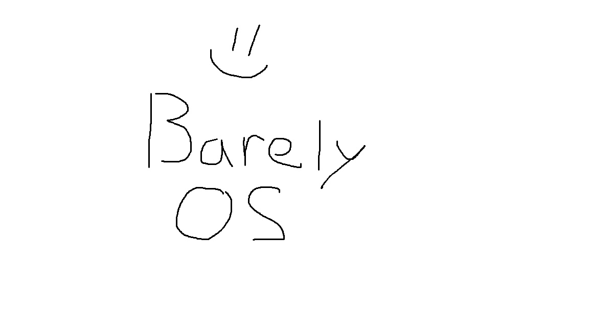

# BarelyOS =)
## An operating system, barely.

*A tiny experimental operating system written from scratch in C++.*

**Is it an operating system? Technically, yes. Does it work? I'm working on that.**

##  What is BarelyOS?

BarelyOS is a small operating system built from scratch as a personal portfolio project.

The goal is simple: demonstrate my understandings of operating systems by creating one.

No fancy desktop environment. No revolutionary features. No plans to replace Windows or Linux. Just a tiny kernel, some C++, and probably an unreasonable amount of debugging.

But remember: **if it's boot, it's already a victory.**

## Project's goals

The long-term goal is to create a minimal but functional operating system capable of booting inside a virtual machine.

Below are the planned features for the v1.0 of BarelyOS:

- [ ] Bootable ISO image
- [ ] Custom kernel
- [ ] Basic IO system
- [ ] Simple CLI
- [ ] Basic memory management
- [ ] Timer interrupts
- [ ] Minimal task scheduling

So, stay tuned for future updates on this small project!

> BarelyOS — An operating system. Barely.

> Copyright © Daegatoya — 2026 | BarelyOS
